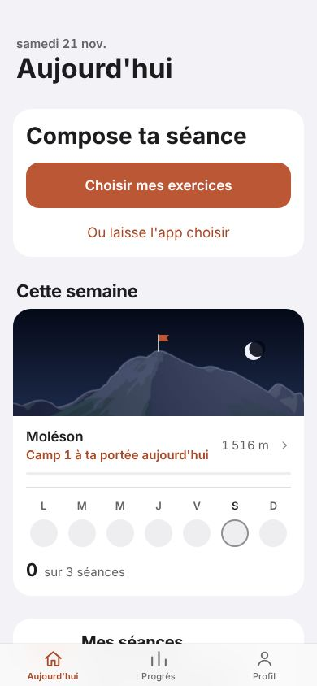
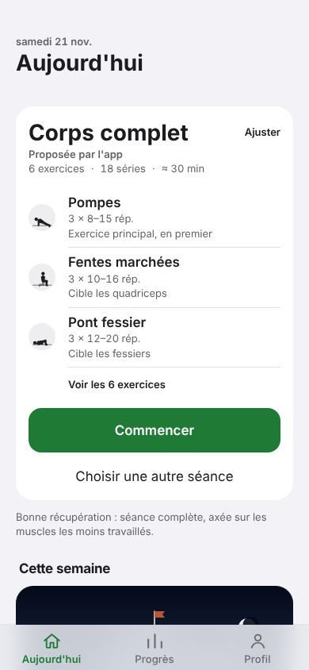
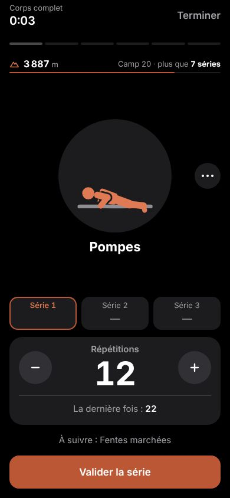
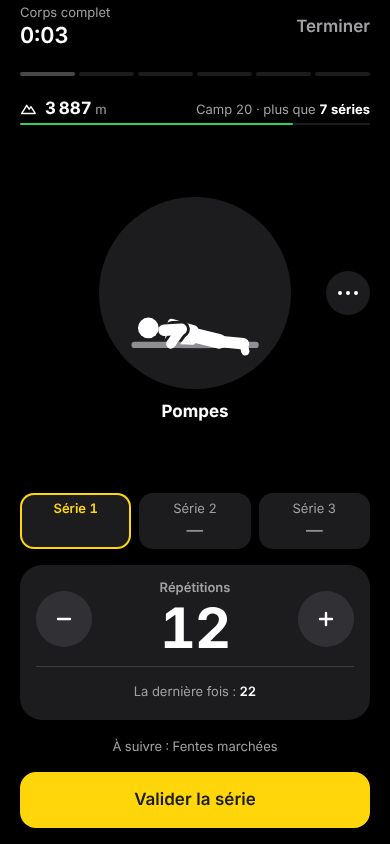
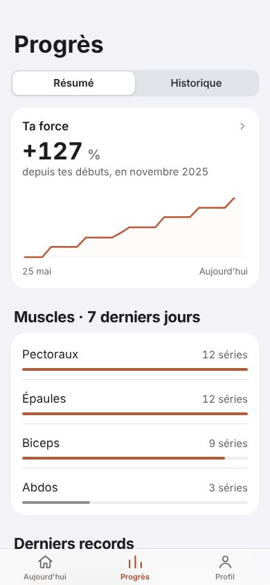
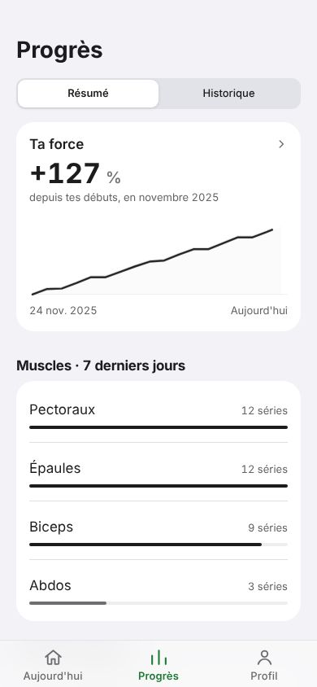
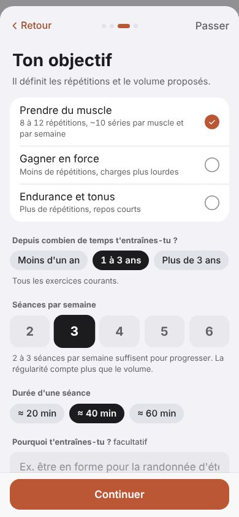
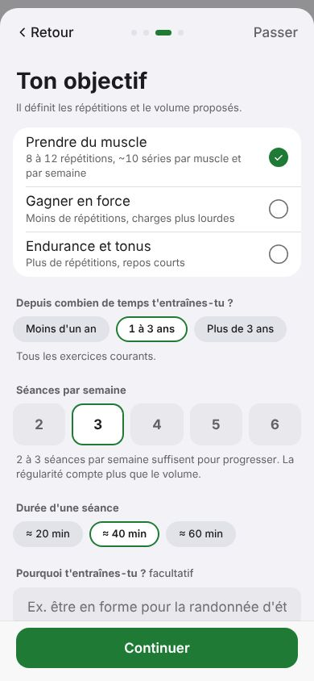
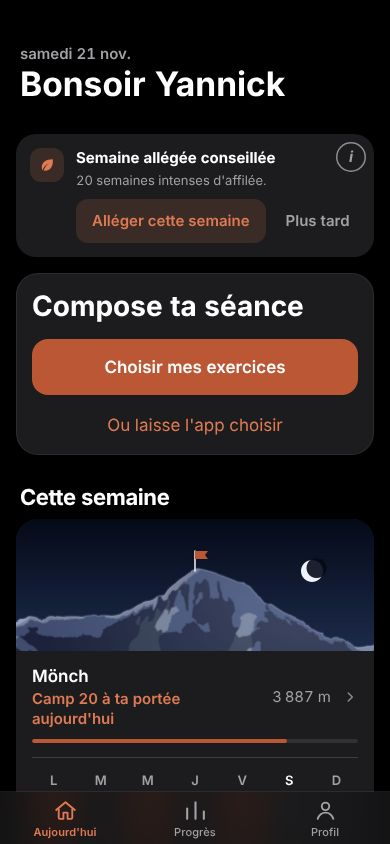
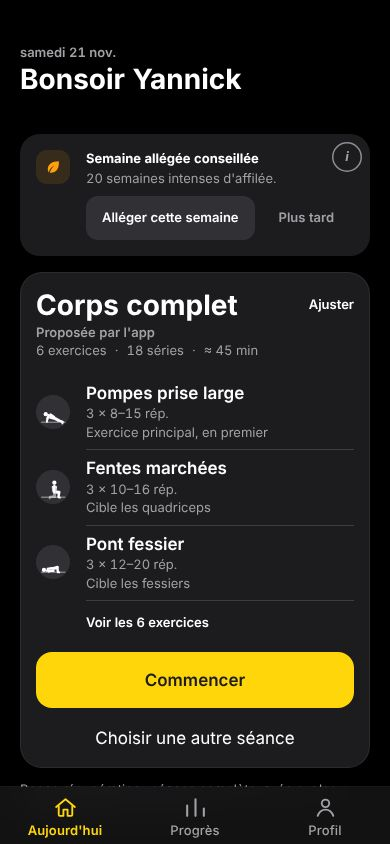

# Review ASCEN — bilan complet (phases 1 à 5)

Branche `review-complete`, point de retour : tag `avant-review` (commit `21ad8bd`, version 2.14.1). Version livrée : **2.15.0** (cache `forge-v113`).
Consigne : [PROMPT-REVIEW.md](PROMPT-REVIEW.md). La branche principale n'a pas été touchée.

## Résumé

Avant la review, l'app était déjà solide sur le fond : stockage double, formules sourcées, aucune injection, aucun code mort. Je n'avais trouvé aucun problème critique. Les 41 problèmes relevés (14 importants, 27 mineurs) portaient surtout sur le cap design, quelques failles de fiabilité des données et des frictions en séance.

**Corrigé** : 35 des 41 problèmes, en 7 commits (un par thème, plus une relecture et une correction de suivi).
- **Cap design appliqué partout** : accent vert en clair et jaune en sombre, réservé à l'action principale et à l'état actif ; vert pour « fait », encre pour les données, orange pour les alertes ; 3 tailles de texte ; marge de 20 px et multiples de 8 ; sélections à bordure d'accent ; plus de textes qui disent quoi faire.
- **Données** :
  - les records sont comptés dans l'historique, le compteur ne dérive plus ;
  - le schéma est versionné, avec des migrations testées sur chaque ancien format ;
  - des données illisibles ne font plus repartir l'app à zéro en silence ;
  - un état vide n'écrase plus la copie de secours ;
  - le repos en cours survit à une fermeture de l'app ;
  - localStorage plein ne fait plus perdre la copie principale.
- **Séance** :
  - une double touche ne saute plus le repos ;
  - le lancement passe de 2,3 s à 1,2 s ;
  - « Valider la série » est 30 % plus rapide ;
  - l'haptique ne vibre plus que sur les validations.
- **Motivation** : quand rien n'est prévu, l'accueil montre une séance prête à « Commencer » en 1 toucher ; formulations sans pression ; courbe de force « depuis tes débuts » cohérente.

**Partiellement corrigé ou non fait** : 6 problèmes, détaillés dans « Ce qui reste ».

## Commits

Dans l'ordre, sur `review-complete` (chaque commit reconstruit `index.html`) :

| Commit | Thème | Contenu |
|---|---|---|
| `c79b9d2` | Données | D1 à D10 : records comptés, migrations versionnées et testées (`tests/v83.js`), données illisibles, état vide, localStorage plein, copie avant restauration, sauvegarde plus récente, 2 décimales, repos gardé, réinitialisation |
| `344c120` | UI | U1 à U17 : cap design, double touche, haptique, textes d'instruction, cibles, contraste, clavier |
| `a98e37a` | Performance | P1 et P2 : lancement resserré, altitude recalculée après la validation |
| `92949d6` | Motivation | M1, M2, M4 : séance de l'app prête sur l'accueil, formulation sans pression, courbe de force |
| `78deaf7` | Code | C3 et C4 : CSP par empreintes, version 2.15.0, HANDOFF.md |
| `06a1f25` | Motivation (suivi) | « Composer moi-même » gardé pour la journée (défaut de M1 trouvé par les tests) |
| `37ef720` | Relecture | Régressions trouvées en relisant le diff, corrigées (voir « Relecture du diff ») |

Plus trois commits de rapport : la consigne, l'audit et les statuts.

## Journal des changements de comportement

Ce qui change pour toi à l'usage, au-delà de l'apparence et de la fiabilité :

1. **Accueil** : quand Ma séance est vide et que rien n'est prévu aujourd'hui, la séance proposée par l'app s'affiche directement, avec « Commencer ». Avant : une carte « Compose ta séance » vide. « Choisir une autre séance › Composer moi-même » reste disponible, et ce choix est gardé jusqu'au lendemain.
2. **Passer le repos** : un toucher sur « Passer le repos » dans les 600 ms qui suivent « Valider la série » est ignoré (c'était presque toujours une double touche).
3. **Retour haptique** : plus de « tac » sur « Lancer le chrono » ni sur « Ajouter un exercice » (qui ouvre une liste). Plus de vibration en fin de repos, un événement automatique ; elle n'existait de toute façon que sur Android.
4. **Trophée « Records »** : il compte les records présents dans l'historique. Si l'ancien compteur était gonflé (séances abandonnées ou supprimées), le nombre affiché baisse ; les paliers déjà gagnés restent acquis.
5. **Repos** : si iOS ferme l'app pendant un repos, le décompte reprend au retour. S'il s'est terminé entre-temps, l'app passe à la série suivante.
6. **Lancement d'une séance** : l'animation dure environ 1,2 s au lieu de 2,3 s, et « Valider la série » est touchable dès son apparition : un toucher dessus pendant l'animation valide la série.
7. **Données illisibles au lancement** : une feuille « Données illisibles » propose de reprendre la dernière copie du jour ou d'enregistrer le fichier abîmé. Avant : l'accueil des nouveaux venus, sans explication.
8. **Réinitialiser** : la confirmation propose d'abord « Faire une sauvegarde » ; le texte précise que les copies automatiques sont aussi effacées.
9. **Restaurer** une sauvegarde faite par une version plus récente d'ASCEN : un avertissement s'ajoute à la confirmation.
10. **Ta force** : la courbe couvre toute la période depuis la première séance (au plus 26 points), au lieu des 26 dernières semaines.
11. **Mon ascension › Cette semaine** : les phrases « pour ne pas redescendre » et « tu redescends d'un camp » sont remplacées. La règle de l'ascension, elle, ne change pas.
12. **Modifier une séance passée** : la charge garde deux décimales (11,25 kg) au lieu d'être arrondie au dixième.
13. **Clavier** : une feuille avec un champ de saisie remonte au-dessus du clavier.

## Mesures avant / après

Chromium headless, CPU ralenti ×4 pour approcher un iPhone. Données générées : 1 an (157 séances), 3 ans (470) ou 5 ans (783).

| Mesure | Avant (2.14.1) | Après (2.15.0) | Commentaire |
|---|---|---|---|
| « Valider la série » (médiane de 8, vraie touche, 3 ans) | ≈ 63 ms | ≈ 44 ms | −30 % : l'ascension est recalculée après l'image de validation |
| « Valider la série » (`tests/perf2.js`, 3 essais) | 44,7 · 45,4 · 44,8 ms | 24,7 · 22,6 · 25,9 ms | −45 % |
| Lancement d'une séance : « Valider la série » touchable | ≈ 2,3 s | ≈ 0,5 s | |
| Lancement d'une séance : fin de l'animation | ≈ 2,4 s | ≈ 1,3 s | |
| Démarrage à froid (DOMContentLoaded, 3 essais) | 0 séance : 351 · 233 · 229 ms ; 1 an : 421 · 403 · 288 ; 5 ans : 474 · 567 · 397 | 0 séance : 363 · 242 · 308 ms ; 1 an : 439 · 383 · 379 ; 5 ans : 527 · 441 · 419 | Inchangé (±80 ms d'un essai à l'autre) |
| Rendu de l'accueil à froid, à mode égal (Ma séance / proposition) | 20–29 / 18–19 ms | 24–25 / 19–20 ms | Inchangé. `perf2` montre +10 ms parce que l'accueil affiche maintenant une séance complète (M1) |
| Écriture complète (`persistNow`) | 1 an : 1,4 ms ; 5 ans : 4,8 ms | 1 an : 1,2 ms ; 5 ans : 4,9 ms | Inchangé |
| `index.html` | 1 085 531 o (316 900 en gzip) | 1 091 976 o (317 502 en gzip) | +0,6 % (+0,2 % en gzip) |
| Tailles de texte par écran (8 écrans mesurés) | 6 à 10 | 3 (28 / 17 / 13), plus les chiffres d'affichage | Seules exceptions : chrono, répétitions, altitude, unités dans un chiffre, libellé de la scène SVG |
| Cibles tactiles de moins de 44 px (8 écrans) | 10 | 0 | |
| Marge latérale | 16 et 20 px mélangées | 20 px partout | |
| Contraste du texte tertiaire (clair) | 2,9:1 | 4,5:1 | |
| Injection HTML dans les champs saisis | aucune exécution | aucune exécution, et gestionnaire injecté bloqué par la CSP | |
| Hors ligne (`tests/offline.js` + Mon ascension) | OK | OK | Service worker, manifeste, icônes, scènes en cache |

## Captures avant / après

Galerie complète : **[review/captures/README.md](review/captures/README.md)**. Elle contient 33 écrans en trois variantes (390×844 clair, 375×667 clair, 390×844 sombre), avant à gauche et après à droite, avec les mêmes données.

Quelques paires représentatives :

| Écran | Avant | Après |
|---|---|---|
| Accueil, première ouverture |  |  |
| Séance en cours (sombre) |  |  |
| Progrès |  |  |
| Onboarding, objectif |  |  |
| Accueil (sombre) |  |  |

Parcours couverts par ces captures et par les tests :
- première ouverture et onboarding ;
- accueil vide, puis avec 1 an de séances ;
- créer une séance : proposition, choix, sélecteur ;
- enregistrer des séries : séance, repos, menu de l'exercice, terminer ;
- fin de séance avec trophées débloqués ;
- progression : Progrès, Ta force, Muscles, Historique ;
- éditer une séance : modification d'une séance passée ;
- profil et réglages ;
- Mon ascension ;
- export et import : `tests/v21.js` (sauvegarde et restauration), `tests/v83.js` (anciens formats) ;
- données corrompues ou absentes : `tests/v35.js` et `tests/v83.js`.

Le clavier ouvert ne se simule pas en headless (voir la liste iPhone).

## Tableau des problèmes (audit de la phase 2, statut après la phase 3)

Gravité : **critique** = perte de données ou fonction principale cassée ; **important** = défaut visible au quotidien, calcul faux ou écart net au cap ; **mineur** = ponctuel, rare ou cosmétique. La colonne **Statut** donne le résultat de la phase 3.

### 1. UI et ergonomie

| # | Gravité | Où | Problème (et pourquoi) | Correction prévue | Statut |
|---|---|---|---|---|---|
| U1 | important | `style.css:6`, `:33`, `:44` (`--tint`), 272 usages de `var(--tint…)` | Accent orange `#BC5736` dans les deux thèmes. Ton cap : jaune en sombre, vert en clair. Attention : un texte blanc sur le vert iOS `#34C759` n'a que 2,2:1 de contraste (illisible). | Redéfinir les jetons `--tint`, `--tint-ink`, `--tint-bg`, `--on-tint` par thème. Sombre : jaune `#FFD60A`, texte noir dessus (14,9:1). Clair : vert foncé `#1E7A35`, texte blanc (5,4:1), ou vert iOS avec texte noir. Retenu : vert foncé `#1E7A35` avec texte blanc en clair, jaune avec texte foncé en sombre. | corrigé |
| U2 | important | jours faits `style.css:2608` et calendrier de l'Historique ; courbes `:343-352` ; barres des muscles `:391` ; « +18 % » d'Avant et maintenant ; « Camp 15 à ta portée aujourd'hui » (`view_today.js:313`) ; « Proposée par l'app », « Exercice principal, en premier », « Voir les 6 exercices » | L'accent sert aussi aux données, aux états « fait » et à des textes d'information. Ton cap le réserve à l'action principale et à l'état actif ; « fait / réussi » doit être vert. | « Fait » et coches en vert de validation. Courbes et barres en encre neutre (`--label` / `--label2`). Textes d'information en `--label2`. L'accent reste sur le bouton principal, l'onglet actif et la sélection. | corrigé |
| U3 | important | `style.css:20-21` (10 tailles), 544 déclarations `font-size` dont ≈ 50 valeurs en dur | Mesuré : 6 à 10 tailles de texte différentes par écran (Mon ascension : 10). Ton cap : 3 tailles. | 3 jetons (titre, corps, légende) et remplacement de toutes les déclarations. Exception documentée pour les grands chiffres de séance (chrono, répétitions, repos), qui sont des affichages et non du texte. Retenu : 28 / 17 / 13. | corrigé (chiffres d'affichage en exception) |
| U4 | important | `style.css:23` (`--gutter:16px`) | Marge latérale de 16 px. Mesuré : titres à 20 px, cartes et contrôles segmentés à 16 px, donc deux alignements sur le même écran. | `--gutter:20px`, tout aligné sur 20 px. | corrigé |
| U5 | important | `style.css:766`, `:774`, `:874`, `:1503` (`.chip.on`, `.type-chip.on`, `.wz-n button.on`) ; `:288-289` (lignes cochées) | Puces et tuiles sélectionnées en aplat noir (onboarding, sélecteur, types de séance) ; lignes cochées sur fond orange. Ton cap : bordure d'accent quand c'est sélectionné. | Sélection = fond neutre et bordure d'accent de 2 px, partout, via une seule règle. | corrigé |
| U6 | important | `view_today.js:930` (« Passer le repos ») et `:959` (« Valider la série »), même emplacement ; garde anti-double appui `ui_shell.js:995` liée à l'élément | **Double touche** : le 2e toucher tombe sur « Passer le repos », qui remplace le bouton au même endroit. Reproduit sur Chromium et WebKit avec 120, 250 et 400 ms d'écart : la série est validée et le repos sauté. | Ignorer « Passer le repos » pendant 600 ms après le début du repos (garde dans `restSkip`, `timer.js:89`). | corrigé |
| U7 | important | `view_today.js:413`, `:1296`, `:1441`, `:1545` ; `view_ascent.js:718`, `:800`, `:861` ; `view_profil.js:114`, `:402-404` ; `onboarding.js:21` ; `tpl_editor.js:44` ; `trophies.js:538` ; `strength.js:226` | Textes qui disent quoi faire (« Planifie une séance dans Mes séances… », « Touche une montagne gravie pour la regravir », « Coche ce que tu as à la maison », « Touche le bouton Partager », « Enregistre-la pour la refaire… », « Choisis le type, la zone et la durée »…). | Supprimer, ou remplacer par l'élément visuel lui-même : bouton direct, icône Partager dessinée, état vide avec une seule action. Les messages d'erreur gardent une phrase factuelle. | corrigé (les feuilles « Comment ça marche » gardent leurs explications) |
| U8 | mineur | `timer.js:40`, `:54` | `navigator.vibrate` à la fin du repos et pendant les 3 dernières secondes : événements automatiques, hors du réglage « Retour haptique ». Sans effet sur iPhone (Safari l'ignore), mais contraire à la règle. | Supprimer ces deux appels. | corrigé |
| U9 | mineur | `view_today.js:649`, `:774` (« Ajouter un exercice ») et `:957` (« Lancer le chrono ») | Haptique sur des actions qui ne sont pas des validations : ouvrir le sélecteur (navigation), démarrer un chrono. Ta règle : un seul « tac », sur les validations. Le réglage « Retour haptique » existe et fonctionne (`fx.js:16-26`). | Bouton normal pour ces trois actions. Le « tac » reste sur Valider la série, Valider sans chrono et S'arrêter (qui valide la série tenue). | corrigé |
| U10 | mineur | `motion.js:339` (`moStart`) | Transition de lancement d'environ 2,3 s. Pendant ≈ 1,3 s, la copie animée affiche le bouton sans libellé et le vrai bouton n'est pas touchable (mesuré). | Ramener la transition sous 600 ms et rendre le bouton actif dès son affichage. | partiel : ≈ 1,2 s au lieu de 2,3 s, bouton touchable dès ≈ 0,5 s (objectif de 600 ms non atteint) |
| U11 | mineur | jours de « Cette semaine » `style.css:2602-2603` (43×60 px) ; Mon ascension : ⓘ 42×42, « Revoir » 95×36, « Bouger la montagne » 36×36 | Cibles tactiles sous 44 px (tous les autres écrans mesurés sont conformes). | Zone de toucher agrandie à 44 px (même procédé `::before` que le reste de l'app). | corrigé |
| U12 | mineur | `style.css:240` (`.seg-ind`) | Contrôle segmenté : la pastille a un liseré de 0,5 px en plus de l'ombre. Ton cap : pastille claire, sans bordure. | Retirer le liseré, garder une ombre douce. | corrigé |
| U13 | mineur | `style.css:23` (`--sp-1` 4, `--sp-3` 12…) et ≈ 300 marges en dur (10, 12, 14 px) | Espacements en multiples de 4, pas de 8. | Jetons 8 / 16 / 24 / 32 ; remplacement écran par écran, captures avant/après pour chaque écran. | corrigé (4 px gardé en demi-pas dans les composants) |
| U14 | mineur | `style.css:5` (`--label3 #8E8E93`, 75 usages) | Texte tertiaire à 2,9:1 sur le fond clair (seuil lisible : 4,5:1). | `#6E6E73` en mode clair (4,5:1 sur le fond, 5,1:1 sur les cartes). Sombre inchangé (5,2:1). | corrigé |
| U15 | mineur | ≈ 55 courbes à rebond (`favPop`, `ckPop`, `badgePop`, ressorts des feuilles…) | Animations qui rebondissent : moins discrètes que ton cap. « Réduire les animations » est bien respecté (vérifié dans `fx.js`, `motion.js`, `view_ascent.js`, confettis, 34 blocs CSS). | Courbes sans dépassement, sauf l'onglet actif. | partiel : courbes sans dépassement ; quelques « pops » par images clés restent |
| U16 | mineur | `trophies.js:477`, `view_today.js:2031` | « reps » (anglais) alors que le reste de l'app écrit « rép. ». | « rép. » partout. | corrigé |
| U17 | mineur | feuilles avec champs (modifier une séance `view_history.js:299-307`, onboarding), aucun usage de `visualViewport` | Clavier ouvert : rien ne garantit que le bouton du bas de la feuille reste visible. Non vérifiable sans vrai clavier. | Mesure de `visualViewport` pour remonter le pied de feuille, à confirmer sur iPhone. | corrigé, à vérifier sur iPhone |

### 2. Fiabilité des données

| # | Gravité | Où | Problème (et pourquoi) | Correction prévue | Statut |
|---|---|---|---|---|---|
| D1 | important | `view_today.js:2004-2008` (abandon), `view_history.js:252-261` (suppression), `core.js:822` ; lu par le trophée « Records » `trophies.js:105` | `S.meta.prCount` est un compteur tenu à la main. Abandonner une séance qui contenait un record, ou supprimer une séance de l'historique, ne le décrémente pas (`recomputePRFlags` ne compte que les séances restantes). Le nombre de records ne fait que monter et peut débloquer un trophée non mérité. Reproduit : 9 records réels, compteur à 10 après un abandon, puis 10 pour 8 records réels après une suppression. | Compter les records directement dans l'historique (somme des séries marquées `pr`, mémoïsée) ; `prCount` recalé une fois au chargement, sans changer le format. | corrigé (`prTotal()` ; l'ancien champ `prCount` est retiré par la migration 2) |
| D2 | important | `core.js:272-276`, `init.js:200-204` | Données principales illisibles et pas de copie IndexedDB : la copie est mise de côté (`forge.v1.illisible.*`), mais l'app repart sur l'onboarding **sans aucun message**, et rien ne permet de récupérer cette copie ni de proposer une copie du jour. | Message au lancement (« Tes données n'ont pas pu être lues… ») avec deux choix : revenir à la dernière copie du jour, ou garder la copie illisible de côté pour l'envoyer. | corrigé |
| D3 | important | `core.js:228-230` (`idbRecover`) | Un état lisible mais vide (par exemple `sessions` qui n'est pas une liste) est accepté sans date d'enregistrement ; la copie IndexedDB, qui contient l'historique, est ignorée puis écrasée par l'état vide dès le lancement (reproduit : 15 séances dans la copie, 0 après 2,5 s). Scénario rare (il faut un état mal formé, par exemple après un bug), conséquence lourde : seules les copies du jour restent. | Si l'état chargé n'a ni séance ni `savedAt` alors que la copie IndexedDB a des séances, reprendre la copie. | corrigé |
| D4 | important | `core.js:13` (`v:1` jamais incrémenté), `core.js:279-408` | Pas de version de schéma ni de migrations ordonnées : les conversions d'anciennes versions (élastiques en kg, `todayMode`, anciens trophées, règle des records) sont mêlées à la validation dans `normalizeState` (131 lignes). Ta règle 3 exige des migrations versionnées et testées. | `S.v` = numéro de schéma, liste ordonnée `MIGRATIONS` (les conversions existantes y passent, sans changer le format actuel), test sur des données d'exemple de chaque ancien format (JSON brut v1, compact `fmt:2`, élastiques en kg, sauvegarde « FORGE »). | corrigé |
| D5 | mineur | `core.js:475-481` | localStorage plein : la copie principale est effacée **avant** que l'écriture IndexedDB soit confirmée. Si IndexedDB échoue aussi, il ne reste que la copie de la veille. Rare (plusieurs décennies de séances avant 5 Mo). | N'effacer la copie principale qu'après l'écriture IndexedDB réussie. | corrigé |
| D6 | mineur | `view_profil.js:363` | La copie « avant restauration » est écrite non compressée dans localStorage et n'est jamais supprimée : elle occupe autant que l'historique et rapproche du plafond de 5 Mo. | La ranger dans IndexedDB (copie du jour) ou la supprimer après 7 jours. | corrigé |
| D7 | mineur | `view_profil.js:354-357` | La restauration ne lit ni `format` ni `version` : une sauvegarde d'une version plus récente de l'app est acceptée sans avertissement. Les fichiers invalides et anciens sont bien gérés (`parseUntrusted`, taille, `normalizeState`). | Avertir si `format` est plus récent que celui de l'app ; garder la lecture des anciens formats. | corrigé |
| D8 | mineur | `view_history.js:273`, `:332` | Modifier une séance passée arrondit la charge au dixième (11,25 kg devient 11,3 kg) et l'affiche avec une seule décimale. | Deux décimales, comme partout ailleurs (`fmtW`). | corrigé |
| D9 | mineur | `timer.js:2-12` | Le repos en cours n'est pas enregistré : si iOS ferme l'app pendant un repos, on revient sans décompte. La séance elle-même est bien conservée. | Enregistrer la fin prévue du repos dans la séance en cours et la reprendre au retour. | corrigé |
| D10 | mineur | `core.js:175-184`, `view_profil.js:784-790` | « Réinitialiser » efface aussi les 7 copies du jour, c'est-à-dire le dernier filet de sécurité. Confirmation unique. | Garder la copie du jour la plus récente, ou proposer « Faire une sauvegarde d'abord » dans la confirmation. | corrigé (sauvegarde proposée ; les copies du jour restent effacées, comme demandé par « tout supprimer ») |

**Vérifié sans problème** :
- **1RM** : moyenne d'Epley (`w × (1 + r/30)`, 1985) et de Brzycki (`w × 36 / (37 − r)`, 1993) jusqu'à 10 répétitions, Epley seul au-delà, la charge elle-même à 1 répétition (`strength.js:34-39`).
- **Volume** : Σ répétitions × charge, élastiques exclus (`core.js:684-706`).
- **Records** : même règle en direct et après coup (`prBeats`), jamais à la 1re fois.
- **Indice de force, désentraînement, statut** : sources citées dans `strength.js:1-30` (LeSuer 1997, Mayhew 2008, Zourdos/Helms 2016, Ebben 2011, Bosquet 2013, McMaster 2013, Williams 2017).
- **Séries de semaines** : semaines avec au moins une séance, la semaine en cours ne casse pas la série, un joker par mois (`core.js:830-863`).
- **Dates** : toujours en heure locale, numéros de jour en UTC, donc pas de décalage au changement d'heure ni à minuit.
- **Deux onglets ouverts** : gérés (`storage`, `adoptNewerStored`).
- **Séance oubliée** : arrêtée à la dernière série (+1 min) après 30 min sans validation.
- **Valeurs** : négatives bornées à 0 ; poids décimaux gardés (`fmtW`).
- **Exercice retiré** : l'historique le garde.
- **Export / import** : export complet et versionné (`{app, format:1, version, exportedAt, data}`) ; import protégé (`parseUntrusted`, 50 Mo max, `normalizeState`) ; CSV protégé contre les formules.

### 3. Performance

| # | Gravité | Où | Problème (et pourquoi) | Correction prévue | Statut |
|---|---|---|---|---|---|
| P1 | mineur | `motion.js:339` (voir U10) | La transition de lancement est le seul vrai temps d'attente mesuré (≈ 2,3 s). | Voir U10. | corrigé (voir U10) |
| P2 | mineur | `view_today.js:1857-1910` (`validateSet`) | Valider une série coûte 46,9 ms à CPU ×4, soit environ une image perdue sur un iPhone ancien : rendu de la carte, recherche des records et « à battre », son, effets. | Profiler et différer ce qui n'est pas visible tout de suite (calcul « à battre » de la série suivante, préparation du repos). Objectif : moins de 30 ms. | corrigé (≈ 63 → 44 ms) |
| P3 | mineur | `style.css` (273 Ko non minifié, 315 sélecteurs redéfinis hors `@media`, 58 `!important`) | Feuille de style analysée à chaque lancement et difficile à faire évoluer. Les règles redéfinies se contredisent (exemple : `.seg button` défini 4 fois). | Dédoublonner les zones touchées par U1-U5 (même passe, pas de chantier séparé). | non fait : les règles touchées ont été remplacées sur place, sans dédoublonnage global (risque sans gain mesurable) |
| P4 | mineur | `index.html` (1,06 Mo) | Tout le code est analysé au lancement, y compris des écrans rares (Mon ascension 120 Ko, Rewind, bilan image, trophées 3D). Le démarrage reste correct (300 à 500 ms à CPU ×4 avec 1 à 5 ans d'historique). | Aucune correction en phase 3 (gain trop faible pour le risque) ; voir Recommandations. | non fait (recommandation) |

**Vérifié sans problème** :
- **Écritures** : différées et regroupées ; copie compressée au plus toutes les 3 s.
- **Démarrage** : aucune écriture pendant la lecture d'IndexedDB ; préchauffage et dessins au calme.
- **Calculs** : mémoïsés par version de données ; aucune fuite d'écouteurs repérée à la lecture (écouteurs globaux posés une fois, feuilles reconstruites).
- **Hors ligne** : le service worker met tout en cache après la première utilisation, scènes et Three.js compris.

### 4. Qualité du code

| # | Gravité | Où | Problème (et pourquoi) | Correction prévue | Statut |
|---|---|---|---|---|---|
| C1 | important | `core.js:822`, `view_today.js:1876`, `:2027`, `:2059` | Cause de D1 : un compteur dérivé (`prCount`) est tenu à la main à 4 endroits au lieu d'être calculé. | Voir D1 : une seule fonction de calcul, les 4 mises à jour manuelles retirées. | corrigé |
| C2 | important | `core.js:279-408` | Validation, réparation et migrations mêlées dans une fonction de 131 lignes (voir D4). | Séparer en `migrate(state)` (versions) et `normalizeState` (validation). Gain concret : chaque futur changement de format aura sa migration et son test. | corrigé (migrations séparées ; la validation reste dans normalizeState) |
| C3 | mineur | `forge_projet/HANDOFF.md:1`, `§9` | Documentation en retard : « APP_VERSION 2.2.7 · forge-v63 » au lieu de 2.14.1 / v112 ; §9 dit « pas de bandeau de mise à jour » alors que la 2.14.0 en a ajouté un. | Mettre à jour l'en-tête et les sections concernées à la fin de la phase 3. | corrigé |
| C4 | mineur | `build.sh:10` (CSP `script-src 'self' 'unsafe-inline'`) | Le code n'utilise aucun gestionnaire en ligne (`onclick=`…). Le script principal pourrait être autorisé par son empreinte, ce qui bloquerait toute injection future, même si un `esc()` était oublié. | CSP avec empreintes `sha256` des deux scripts en ligne, calculées par `build.sh`. | corrigé |
| C5 | mineur | `ascBuildScene` (112 lignes, 12,5 Ko), `ascent_raw` (152 lignes), `suggestForExo` (119 lignes), `moStart` (107 lignes) ; 102 lignes de plus de 200 caractères dans `view_ascent.js`, 77 dans `view_today.js` | Fonctions longues et lignes très denses : relecture difficile. | Pas de refonte gratuite : découper seulement les fonctions que la phase 3 modifie (`moStart`, `normalizeState`). | non fait : aucune fonction découpée, pas de gain concret |

**Vérifié sans problème** :
- **XSS** : HTML injecté dans le prénom, le pourquoi, les noms de séance, les notes, le matériel perso et Mes séances, puis tous les écrans et 10 feuilles ouverts : aucune exécution.
- **Code mort** : 955 fonctions, aucune jamais appelée, aucune définie deux fois. Tous les `data-a` ont leur action.
- **Erreurs** : erreurs globales et promesses rejetées journalisées (`ERR_LOG`) ; un écran qui échoue affiche « Réessayer » sans bloquer l'app.
- **Tests** : 80 suites Playwright couvrent l'app, voir « État des tests ».

### 5. Motivation de l'utilisateur

| # | Gravité | Où | Problème (et pourquoi) | Correction prévue | Statut |
|---|---|---|---|---|---|
| M1 | important | `view_today.js:135-138`, réglage par défaut `todayTab:"custom"` (`core.js:29`) | Première ouverture et tout jour sans séance prévue : l'accueil affiche une carte « Compose ta séance » vide. L'onboarding promet « Une séance prête chaque jour ». Lancer une séance demande 2 touches (« Ou laisse l'app choisir », puis « Commencer ») et un choix à faire. | Quand Ma séance est vide et que rien n'est prévu, afficher directement la séance proposée par l'app (« Commencer » en 1 touche, « Choisir mes exercices » en lien secondaire). Changement de comportement : noté au journal. Retenu, avec le choix « Composer moi-même » gardé pour la journée. | corrigé |
| M2 | mineur | `view_ascent.js:718` | « Fais au moins une séance d'ici dimanche pour ne pas redescendre. » : formulation qui met la pression. | Formulation neutre tournée vers le prochain camp. Le mécanisme de descente lui-même est traité dans les Recommandations. | corrigé |
| M3 | mineur | `trophies.js:96-131` | 1re séance, même une seule série de 13 s : 2 à 4 trophées bronze d'un coup (Assiduité, Guerrier du week-end, Lève-tôt…, seuils à 1). Les trophées perdent de la valeur, et une séance d'une série compte pleinement pour la série de semaines et l'ascension. | Rien en phase 3 (règle de jeu) ; voir Recommandations. | non fait (recommandation) |
| M4 | mineur | `view_progress.js:117-127` (carte « Ta force ») | « +127 % depuis tes débuts, en novembre 2025 », mais la courbe est limitée à 26 semaines et commence le 25 mai : les deux repères ne correspondent pas. | Courbe sur toute la période (points regroupés au-delà de 26 semaines), ou date de départ de la courbe dans le texte. | corrigé |
| M5 | mineur | voir U6 et U10 | Repos sauté par erreur et lancement lent : deux frictions au cœur de la séance. | Voir U6 et U10. | corrigé (voir U6 et U10) |

**Vérifié sans problème** :
- **Validation d'une série** : son, coche animée, haptique, « Mieux que la dernière fois », « Record ! ».
- **Progression visible** : force, records, avant/maintenant, calendrier, Rewind.
- **Absence sans culpabilité** : joker mensuel, 2 pauses par trimestre, « Retour en force ».
- **Fin de séance** : complète et gratifiante (tonnage, ascension, trophées, « Garder cette séance ? »).

## État des tests

Batterie complète du dépôt (`tests/run_all.js`) : 80 suites × Chromium et WebKit, 4 audits de mise en page (320, 390 et 430 px, sombre), génération de 11 520 séances, 250 touchers aléatoires. Plus le test hors ligne.

| | Avant (2.14.1) | Après (2.15.0) |
|---|---|---|
| Suites vertes | 145 / 150 | 149 / 152 (dont la nouvelle `v83`, × 2 moteurs) |
| Échecs | chromium v67, v82 ; webkit v12, v51, v82 | chromium v27 (passe seul 2 fois sur 2 : instable sous charge) ; v82 × 2 |
| Hors ligne | — | OK |

- **v82** échouait avant la review et échoue toujours : le moteur propose une séance de 10 min au lieu de 40 pour un niveau avancé avec une seule paire d'haltères de 10 kg. C'est le moteur de propositions, hors de ce périmètre.
- **v67, v12, v51, v36, v49, v27** échouent par moments sous charge (4 suites en parallèle) et passent seules, avant comme après la review.
- **Tests ajoutés** : `tests/v83.js`. Il couvre les migrations sur chaque ancien format, les records, les données illisibles, l'état vide, localStorage plein, le repos repris, la double touche et les 2 décimales.
- **Tests adaptés au nouveau comportement** (jamais désactivés) :
  - v35 : réinitialisation ;
  - v33, v40 : accueil ;
  - v44, v59 : couleurs du cap ;
  - les suites qui passent le repos attendent maintenant 650 ms.

## Relecture du diff et régressions corrigées

J'ai relu `git diff avant-review..review-complete` (JS ligne à ligne, CSS par comparaison automatique règle à règle) et repassé chaque écran en capture. Voici ce que j'ai trouvé et corrigé :

| Trouvé | Où | Correction |
|---|---|---|
| Texte blanc sur l'accent jaune (illisible en mode sombre), dans 8 règles écrites en dur | `style.css` (`.sx .validate`, `.hero-go`, `.next-exo`…) | `--on-accent` (texte foncé sur le jaune) |
| Taille de base de la page passée à 16 px (la passe typographique avait remplacé le `font-size:17px` racine par un alias qui dépendait de lui-même) | `style.css`, `html{}` | 17 px rétablis |
| 28 marges négatives de centrage ou de compensation arrondies par la passe d'espacement (ex. rond de 20 px décalé de 2 px) | `style.css` | Valeurs d'origine rétablies |
| Conteneurs pleine largeur restés à 16 px de marge (Mon ascension, feuilles, puces) | `style.css` | `var(--gutter)` (20 px) |
| En-tête « Mes séances » et lien « Voir les N exercices » décalés de 4 et 2 px | `style.css` | Réalignés (test v63) |
| « Composer moi-même » puis annulation : l'accueil revenait à la séance de l'app | `view_today.js` (M1) | Choix gardé pour la journée |
| Garde de « Passer le repos » appliquée aussi aux appels directs du code | `timer.js` | Seulement pour un vrai toucher |
| Variable de portée de bloc : le recalcul différé de l'altitude ne se déclenchait jamais | `view_today.js` | Déclarée au bon niveau ; gain mesuré ensuite |
| Jours du programme : la bordure d'accent annulée par une ancienne règle | `style.css` (`.te-days button.on`) | Bordure rétablie |
| Vignettes de thème, icône « Séries » du menu et pastille de fin de séance encore en orange ; « jamais » (sauvegarde due) non signalé comme alerte | `style.css` | Accent, encre ou orange d'alerte selon le cas |
| « Ton prénom » (profil sans prénom) affiché comme un vrai prénom | `view_profil.js`, `style.css` | Gris tertiaire |

## Ce qui reste

| # | Statut | Pourquoi |
|---|---|---|
| U10 / P1 | partiel | Le lancement dure ≈ 1,2 s (objectif : 600 ms). L'animation « liquide » est une signature de l'app : je l'ai resserrée sans la supprimer. Le bouton est utilisable dès ≈ 0,5 s. |
| U15 | partiel | Toutes les courbes de transition sont sans dépassement, mais quelques « pops » par images clés (`badgePop`, `ckPop`) restent : ce sont des animations dessinées, pas des courbes. |
| P3 | non fait | La feuille de style garde des règles redéfinies plusieurs fois. Un dédoublonnage global touche 3 500 lignes pour un gain non mesurable : trop risqué pour cette review. |
| P4 | non fait | Charger les écrans rares à la demande demande de découper le build en modules (voir Recommandations). |
| C5 | non fait | Aucune longue fonction n'a dû être modifiée en profondeur : les découper n'apportait pas de gain concret. |
| M3 | non fait | Le dosage des trophées est une règle de jeu, je ne la change pas sans ton accord (voir Recommandations). |

Autres points connus :
- Les icônes de l'app (`icon-*.png`, `favicon.svg`) sont encore à l'ancien orange : une icône installée ne change qu'après réinstallation, c'est à toi de décider de la nouvelle.
- Les feuilles « Comment ça marche » gardent leurs explications (elles expliquent un calcul, elles ne disent pas quoi toucher).
- Le test v82 (moteur de séances : une seule paire d'haltères de 10 kg en niveau avancé donne une séance trop courte) échouait déjà avant la review ; il concerne le moteur de propositions, hors de ce périmètre.

## Recommandations (grosses évolutions non faites)

1. **Ascension sans recul** : une semaine sans séance pourrait geler l'altitude au lieu de faire redescendre d'un camp, avec le même bonus au retour. La perte d'altitude reste la seule mécanique qui punit une absence.
2. **Trophées mieux dosés** : relever les seuils bronze à 1 des familles « style » (week-end, lève-tôt, midi, nuit), qui tombent par 2 à 4 dès la première séance ; ne compter une séance qu'à partir de 3 séries validées (aujourd'hui, une série de 13 s compte pour les trophées, la série de semaines et l'ascension).
3. **Lancement encore plus court** : une version courte de l'animation (≈ 500 ms) par défaut, la version longue réservée à la première séance de la semaine.
4. **Chargement à la demande** des écrans rares (Mon ascension 120 Ko, Rewind, bilan image) comme pour Three.js : environ 20 à 30 % de code analysé en moins au lancement.
5. **Dédoublonnage de `style.css`** par composant, avec captures avant/après de chaque écran.
6. **Ascension incrémentale** : mémoriser l'état de l'ascension à la fin de la semaine précédente pour ne recalculer que la semaine en cours (aujourd'hui tout l'historique est relu après chaque série, en différé).
7. **Nouvelle icône d'app** aux couleurs de l'accent.
8. **Bilan de la semaine** (déjà dans PLAN.md) : une carte le dimanche soir avec séances, records, montée et objectif de la semaine suivante.

## À tester sur ton iPhone

Les 10 points que je ne peux pas vérifier sans l'appareil :

1. **Haptique** : un seul « tac » sur « Valider la série », « Valider sans chrono » et « S'arrêter » ; aucun sur la navigation, les fermetures, « Lancer le chrono », « Ajouter un exercice » ni la fin du repos.
2. **Réglage « Retour haptique »** coupé : plus aucun « tac » ; réactivé : il vibre au moment de l'activer.
3. **Clavier** : dans « Modifier la séance » (historique), l'onboarding (prénom, pourquoi) et le nom d'une séance, le champ et le bouton du bas restent visibles au-dessus du clavier.
4. **Zones de sécurité** dans l'app installée : en haut (encoche ou Dynamic Island) et en bas (trait d'accueil), sur l'accueil, en séance, sur les feuilles et sur la page de fin.
5. **Double touche** rapide sur « Valider la série » : la série est validée une fois et le repos démarre bien.
6. **Couleurs au soleil** : lisibilité du vert (mode clair) et du jaune avec texte foncé (mode sombre et séance), y compris l'anneau de repos et l'île du repos (Dynamic Island).
7. **Repos et verrouillage** : verrouiller pendant un repos, attendre, revenir : le décompte reprend, ou la série suivante s'affiche s'il est fini.
8. **Sauvegarde et restauration** : « Sauvegarder mes données » vers Fichiers ou iCloud, puis « Restaurer une sauvegarde » depuis ce fichier.
9. **Réduire les animations** (Réglages › Accessibilité › Mouvement) : pas de transition de lancement, pas de confettis, chiffres posés directement.
10. **Mise à jour hors ligne** : ouvrir l'app installée en ligne (bandeau « Nouvelle version », Mettre à jour), puis en mode Avion : tout s'ouvre, y compris Mon ascension et les trophées 3D.

## Annexe A — Cartographie (phase 1)

1. **Architecture** : PWA mono-fichier. `forge_projet/build.sh` concatène 33 fichiers JS (≈ 15 000 lignes) et `style.css` (3 481 lignes) en `index.html` (1,06 Mo, minifié par esbuild). Scripts globaux partagés, sans modules ni framework. Boutons déclaratifs `data-a="nom"` → `ACT.nom()` via un répartiteur unique (`ui_shell.js`). Service worker « cache d'abord » (`sw.js`). Three.js (trophées 3D) et scènes de montagne chargés à la demande.
2. **Modèle de données** : un objet `S` (`core.js`) : `sessions` (séances terminées → exercices → séries `{reps, weight, done, pr, effort, goal}`), `draft` (séance proposée ou en cours), `custom` / `templates` (Ma séance, Mes séances et leurs jours), `equipment`, `prefs`, `goals`, `settings`, `medals`, `targets`, `challenges`, `body`, `deload`, `ascent`, `meta` (compteurs, sauvegardes).
3. **Stockage** : localStorage `forge.v1` (JSON, historique compacté dans `zs`, écriture 400 ms après chaque `save()` et à la sortie), miroir IndexedDB gzip (`forge/state`, au plus toutes les 3 s), 7 copies du jour (`forge/snap`). `normalizeState` valide et répare chaque chargement et chaque import. Records, séries de semaines, force, ascension et trophées sont **recalculés depuis l'historique** et mémoïsés (`DATA_VER`, `memoHist`, `sessionSummary`).
4. **Écrans** : 3 onglets. Aujourd'hui (carte du jour, Cette semaine / ascension, Mes séances). Progrès (Résumé : force, muscles, records, avant/maintenant, statistiques | Historique : calendrier, séances, Rewind). Profil (trophées, réglages, données). Feuilles : Mon ascension, fiche exercice, sélecteur, éditeurs, onboarding en 4 étapes.
5. **Flux principal** : accueil → séance prévue, composée ou proposée → « Commencer » → carte de l'exercice (− / +, glisser, « Valider la série ») → repos (anneau, ressenti) → … → fin automatique → page de fin (records, ascension, trophées, « Garder cette séance ? ») → Progrès et Historique recalculés.
6. **Moteurs** : `engine.js` / `tailor.js` (propositions, double progression), `strength.js` (indice de force), `ascent.js` (13 montagnes, camps), `trophies.js` (42 familles × 4 paliers), `coach.js` (fatigue en séance).

## Annexe B — Méthode de l'audit

- Lecture du code : `core.js` et `init.js` en entier ; `ui_shell.js`, `timer.js`, `fx.js`, sauvegarde/restauration (`view_profil.js`), historique (`view_history.js`), validation et fin de séance (`view_today.js`), formules (`strength.js`), trophées ; recherche ciblée dans le reste (textes affichés, couleurs, tailles, échappement).
- L'app réelle lancée dans Chromium et WebKit headless (390×844 et 375×667, clair et sombre), avec 0 séance, 1 an et 5 ans de séances générées.
- Scripts d'essai : injection de HTML dans tous les champs saisis, données corrompues (5 cas), double touche, cibles tactiles, tailles de texte par écran, contrastes, code mort, actions sans gestionnaire.
- Captures : voir « Captures avant / après » (la première série de 45 captures a été remplacée par 33 écrans × 3 variantes, comparables avant/après).

## Annexe C — Mesures de référence (avant correction)

| Mesure | Valeur |
|---|---|
| `index.html` | 1 085 531 octets (316 901 en gzip) |
| `ascent-scenes.js` / `three-forge.js` (à la demande) | 695 361 / 617 941 octets (143 098 / 159 159 en gzip) |
| Démarrage, Chromium, CPU ×4 (DOMContentLoaded, 3 essais) | 0 séance : 219–396 ms · 1 an (157 séances) : 305–402 ms · 5 ans (783) : 386–515 ms |
| Écriture complète (`persistNow`), CPU ×4 | 1 an : 1,8 ms · 5 ans : 3,7 ms |
| Taille stockée (`forge.v1`) | 1 an : 58 Ko · 5 ans : 274 Ko (limite localStorage ≈ 5 Mo) |
| `tests/perf2.js` (3 ans, 470 séances, CPU ×4) | accueil 21,1 ms · Progrès 19,1 ms · Profil 12,5 ms · changement d'onglet médian 6,3 ms (max 35,7) · valider une série 46,9 ms · 1 image longue sur 69 à l'entrée de l'accueil |
| Lancement d'une séance (toucher → bouton utilisable) | ≈ 2,3 s de transition, dont ≈ 1,3 s où « Valider la série » n'est pas touchable |
| Tests existants (80 suites × 2 moteurs + audits) | voir « État des tests » |

